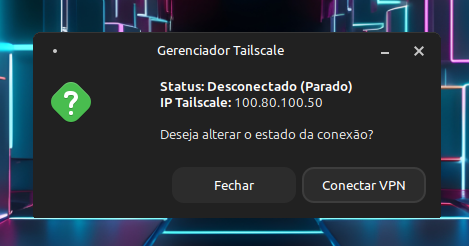

# Tailscale Toggle para XFCE (Linux Mint / Ubuntu)

Aplicativo leve e indicador de painel para ativar e desativar a VPN **Tailscale** com um clique no ambiente **XFCE** (testado no Linux Mint 22.3 XFCE).

## Capturas de Tela

| Painel (Conectado) | Painel (Desconectado) | Janela de Gerenciamento |
| :---: | :---: | :---: |
|  |  |  |

## Funcionalidades

- **Ícone dinâmico no painel (`genmon`):** Muda de cor automaticamente entre verde (conectado) e cinza (desconectado).
- **Alternância instantânea:** Liga ou desliga o Tailscale sem pedir senha a cada clique.
- **Janela gráfica (Zenity):** Ao abrir pelo Menu Iniciar, exibe o status atual, o IPv4 do Tailscale e botões rápidos de ação.
- **Configuração automática:** O instalador `.deb` configura `/etc/sudoers.d/tailscale-toggle` com segurança durante a instalação e remove tudo na desinstalação.

## Instalação Rápida (em uma linha)

Execute o comando abaixo no terminal para baixar e instalar automaticamente a última versão:

```bash
curl -fsSL https://githubusercontent.com | bash
```

*(Alternativamente, você pode baixar o arquivo `.deb` manualmente na seção **[Releases](../../releases)** e instalar com `sudo apt install ./tailscale-toggle_1.1_all.deb`).*

## Configuração no Painel do XFCE

1. Clique com o botão direito no painel → **Painel** → **Adicionar novos itens**.
2. Procure por **Monitor Genérico** (*Generic Monitor*) e clique em **Adicionar**.
3. Clique com o botão direito no novo item no painel → **Propriedades**:
   - **Comando:** `tailscale-toggle`
   - **Rótulo:** Desmarque a caixa de seleção
   - **Período (s):** `2,00`
4. Reinicie o painel para aplicar imediatamente:
   ```bash
   xfce4-panel -r
   ```

## Como compilar o `.deb` a partir do código-fonte

```bash
git clone https://github.com
cd tailscale-toggle-xfce
./build.sh
```
